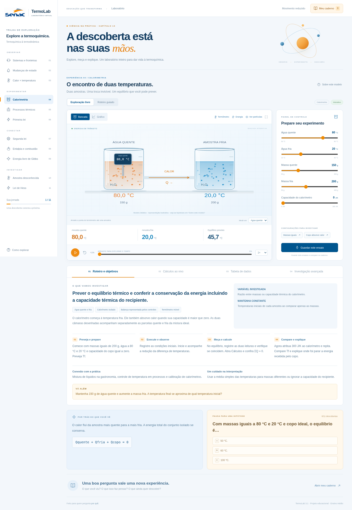
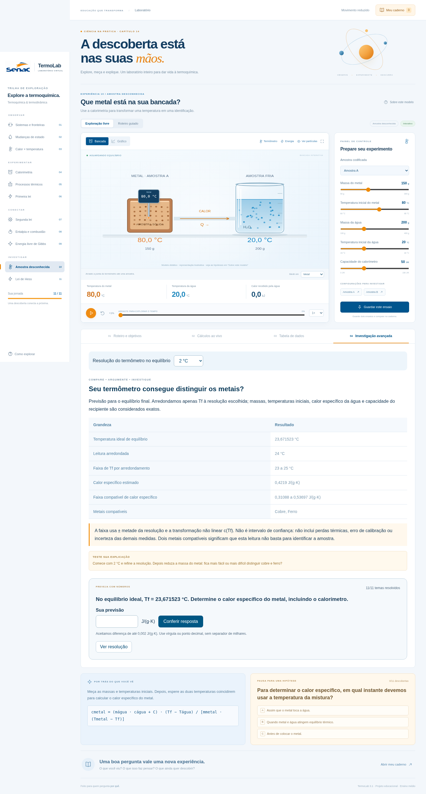

# TermoLab 3.1 · A descoberta está nas suas mãos

Um laboratório de investigação em **TypeScript estrito + Vite**, em português. Onze experiências conectam os assuntos do capítulo 14 de termoquímica: de sistemas e fronteiras à energia livre de Gibbs, com investigações de Lei de Hess e identificação calorimétrica de metais. A interface usa azul e laranja e a logo do Senac fornecida como referência.



## Explorar

- **Instrumentos na bancada:** arraste a ponta do termômetro até uma amostra ou escolha o alvo no seletor. Fora das amostras, a sonda não inventa uma leitura. Use as setas do teclado para mover a sonda; Shift acelera o deslocamento.
- **Pistão manipulável:** no experimento de processos, arraste o pistão para definir o volume do estado final. As setas e Home/End também funcionam. Na isocórica, o volume fica travado.
- **Exploração livre e roteiro guiado:** quatro etapas específicas para cada experiência, com objetivo, materiais, variável investigada, condições mantidas, aplicação e cuidado de interpretação.
- **Cálculos ao vivo:** equações com os valores numéricos atuais, unidades, conversões e verificação dos balanços. A amostra desconhecida só é identificada quando chega ao equilíbrio.
- **Tabela de medições:** registre até 60 leituras ao todo, com condições experimentais e valores sem perda de precisão no CSV. Os dados permanecem salvos neste navegador e também entram na exportação JSON do caderno.
- **Ferramentas visuais:** partículas, setas de energia, sonda, passo de 1% e modo de bancada ampliada.

- **Bancada e gráfico:** duas representações do mesmo estado, com partículas, recipientes, pistão, máquina térmica e balanços de energia.
- **Linha do tempo reversível:** pause, avance ou retorne a qualquer ponto da experiência. Mudar um parâmetro reinicia a evolução.
- **22 ideias prontas:** configurações para investigar contrastes, como um copo aberto e uma garrafa ideal, ou uma máquina real e o limite reversível.
- **Caderno Ver–Pensar–Perguntar:** anotações, até 12 ensaios, retomada de configurações e exportação em JSON. Armazenamento local no navegador, sem conta.
- **Comparação:** os dois últimos ensaios do assunto atual aparecem lado a lado no caderno. No gráfico, uma curva tracejada mostra o último ensaio guardado; processos com eixos incompatíveis não são sobrepostos.
- **Onze hipóteses:** perguntas com feedback explicativo e progresso salvo.
- Layout adaptado a celular, navegação por teclado, ajuda, descrição dos modelos e opção de reduzir movimento.

## Investigação avançada · novidade da versão 3.1

A quarta aba de cada experiência traz uma comparação quantitativa que acompanha os controles da bancada:

- **Sistemas:** constante de tempo, meia diferença de temperatura e potência inicial de troca.
- **Mudanças de estado:** energia e tempo de cada etapa, com atalhos para observar seus pontos intermediários.
- **Calor e temperatura:** capacidades térmicas e aquecimento de água, cobre e alumínio com a mesma energia.
- **Calorimetria:** diferença entre considerar e ignorar o recipiente no equilíbrio.
- **Processos:** tabela dos quatro processos com temperatura, pressão, calor, trabalho e energia interna.
- **Primeira lei:** diferentes pares de calor e trabalho para uma mesma variação de energia interna.
- **Segunda lei:** entropia de cada reservatório e trabalho perdido em relação ao limite reversível.
- **Entalpia:** quantidades estequiométricas, calor da reação e calor recebido pelo banho.
- **Gibbs:** entropia do sistema, da vizinhança e do universo; temperatura de inversão quando existe.
- **Metais:** resolução selecionável de 0,01 a 2 °C, faixa de calor específico e metais compatíveis com a leitura.
- **Hess:** soma das etapas e cancelamento do intermediário, incluindo reação inversa.

Cada tema tem um **desafio numérico** gerado com os parâmetros atuais: aceita vírgula ou ponto decimal, explica erros, informa a tolerância e oferece resolução sob demanda. O progresso dos onze temas fica salvo no navegador. As análises avançadas são previsões para o estado final; os cálculos ao vivo continuam mostrando o instante da animação. Os roteiros orientam hipóteses e comparação com a observação.



## Experiências do capítulo

| Tema                                | Investigação                                     | Modelo                                                                       |
| ----------------------------------- | ------------------------------------------------ | ---------------------------------------------------------------------------- |
| Sistemas térmicos e fronteiras      | O que pode atravessar a fronteira?               | Tanque aberto, fechado ou isolado; calor e transporte de energia por matéria |
| Mudanças de estado                  | Por que a temperatura para de subir?             | Água a 1 atm: gelo, fusão, líquido, ebulição e vapor                         |
| Calor e temperatura                 | Mesmo calor produz a mesma temperatura?          | Água, cobre e alumínio; Q = mcΔT                                             |
| Calorimetria                        | Qual será a temperatura de equilíbrio?           | Duas massas de água e capacidade térmica do calorímetro                      |
| Formas de estudar sistemas térmicos | Como o caminho altera a transformação?           | Gás ideal em processos isotérmico, isocórico, isobárico e adiabático         |
| Primeira lei                        | Como fechar o balanço energético?                | ΔU = Q + W, trabalho sobre o sistema positivo                                |
| Segunda lei                         | Quanto calor pode virar trabalho?                | Máquina térmica, limite de Carnot e entropia do universo                     |
| Entalpia e aplicação à química      | Qual é a assinatura térmica de uma reação?       | Combustão do metano, neutralização e decomposição de CaCO₃                   |
| Energia livre de Gibbs              | Em quais condições a transformação é favorecida? | ΔG = ΔH − TΔS e temperatura de inversão                                      |

### Investigações adicionais

- **Amostra desconhecida:** água e calorímetro recebem energia de um metal. Calcule o calor específico a partir do equilíbrio e compare com cobre, alumínio e ferro. Alterar a massa muda a temperatura final, mas não o calor específico do mesmo material.
- **Lei de Hess:** compare a formação direta de CO₂ com a rota por CO. Inverta o sentido das etapas ou multiplique a quantidade de reação. Confira o cancelamento do intermediário e a soma das entalpias.

## Executar

Requer **Node.js 22.12+**, validado com Node 24. No GitHub, use **Code → Download ZIP**, extraia e abra um terminal na pasta:

```sh
npm ci
npm start -- --port 5173
```

Se já tiver uma cópia Git no computador, pare o servidor antes de atualizar:

```sh
git switch main
git pull --ff-only origin main
npm ci
npm start
```

A versão nova mostra **TermoLab 3.1** no rodapé e **11 experiências** na navegação. Se o Git informar conflito ou arquivos locais modificados, preserve seu trabalho antes de continuar.

Para gerar os arquivos do site:

```sh
npm run build
```

O resultado fica em `dist/`. O projeto usa apenas arquivos locais: não exige banco, chaves de API, fontes externas ou serviços de IA. O envio do código ao GitHub não publica automaticamente um site.

## Verificar

```sh
npm test             # 25 testes científicos, instrumentos e casos de fronteira
npm run check        # TypeScript estrito
npm run build        # checagem de tipos + compilação
npm run test:browser # servidor na porta 5173 deve estar ativo
```

O teste de interface usa Chromium em `/usr/bin/chromium`. Para outro sistema, configure `CHROMIUM_PATH` com o caminho de um Chromium/Chrome instalado. `TERMOLAB_URL` altera o endereço do servidor de teste.

O teste de navegador cobre os onze assuntos, 22 presets, onze gráficos, hipóteses, reprodução, controle do tempo, comparação, restauração, persistência, exportação JSON, condições de Gibbs e Carnot, controles condicionais, celular e diálogos. Também valida o termômetro por arraste e teclado, o pistão manipulável, os roteiros, cálculos, leituras persistidas e exportação CSV, onze desafios numéricos, resolução do termômetro, atalhos das fases e a nova aba em celular. As capturas de validação ficam em `/tmp/termolab-senac-desktop.png` e `/tmp/termolab-senac-mobile.png` no ambiente da nuvem.

## Organização

- `physics.ts`: funções puras, unidades e modelos físicos.
- `experiments.ts`: currículo, controles, configurações, perguntas e medições.
- `lessons.ts`: objetivos, roteiros, interpretação e cálculos numéricos dos 11 experimentos.
- `investigation.ts`: análises comparativas, desafios numéricos e propagação da resolução do termômetro.
- `instruments.ts`: zonas de amostra e leitura física da sonda.
- `scene.ts`: desenho dos aparatos e partículas em Canvas.
- `app.ts`: reprodução, gráficos SVG, caderno e persistência.
- `icons.ts`, `style.css`, `index.html`: identidade visual e interface.
- `physics.test.ts`, `tests/browser.ts`: validação científica e funcional.

## Hipóteses e limites

A opção **Sobre este modelo** descreve as condições de cada experiência. Os desenhos e as partículas são ilustrativos, sem escala molecular real.

- Água: c(gelo) = 2,1, c(líquido) = 4,18 e c(vapor) = 2,0 J/(g·K); Lf = 334 e Lv = 2256 J/g, a 1 atm. A potência determina o tempo físico; reprodução acelerada 20× antes do multiplicador selecionado.
- Sistemas: água líquida em tanque bem misturado; condução de 1,8 W/K. No sistema aberto, entram e saem 0,5 g/s e a massa interna se mantém. A variação térmica usa a aproximação de líquido incompressível, sem trabalho de expansão. Reprodução física 40×.
- Calorimetria: conjunto isolado e calorímetro inicialmente à temperatura fria. A trajetória interpola a troca conservando energia em cada instante; não pretende prever a cinética real da mistura.
- Gás: 1 mol ideal monoatômico, R = 8,314462618 J/(mol·K), Cv = 3R/2, estado inicial 300 K e 100 kPa; processos quase estáticos reversíveis.
- Máquina: reservatórios em kelvin, ciclo completo com ΔU = 0. A eficiência ajustada é uma fração do limite de Carnot e ΔS é a variação total por ciclo.
- Reações: ΔH constante, banho inicialmente a 25 °C e recipiente ideal. O avanço é ilustrativo. A decomposição de CaCO₃ requer altas temperaturas na prática; a temperatura calculada é a do banho, não a da reação.
- Gibbs: transformação hipotética a T e p constantes, ΔH e ΔS independentes da temperatura. ΔS em J/(mol·K) é convertido para kJ antes do balanço. Favorabilidade não determina velocidade.

- Termômetro: instrumento ideal, sem atraso e sem capacidade térmica. A temperatura é a da amostra sob a ponta; a sonda não altera o balanço. As duas câmaras de calorimetria representam as parcelas de uma mistura ideal.
- Amostra desconhecida: água, recipiente e metal formam conjunto isolado. O cálculo usa a temperatura de equilíbrio sem arredondamento; a interface mostra valores arredondados. A aba Investigação avançada permite arredondar a leitura de equilíbrio e propagar a faixa de ± meia resolução para o calor específico. Essa faixa considera somente a quantização de Tf; não é intervalo de confiança nem inclui perdas, calibração ou incerteza das demais grandezas.
- Hess: C(grafite) → CO → CO₂, com etapas −110,5 e −283,0 kJ/mol; total −393,5 kJ/mol. O percurso é uma coordenada didática, não tempo ou cinética. Inverter a reação inverte também a ordem e o sinal das etapas.

## Identidade visual

`public/senac.png` é a versão para a interface preparada por edição da referência visual enviada pelo usuário. O arquivo é servido localmente. A tela não depende de recursos carregados de sites externos.

Projeto educacional independente, inspirado na aprendizagem por exploração do PhET. Não utiliza o código nem se apresenta como uma simulação oficial do PhET.
